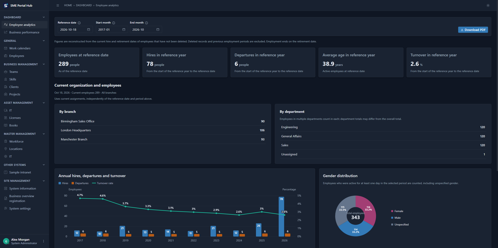
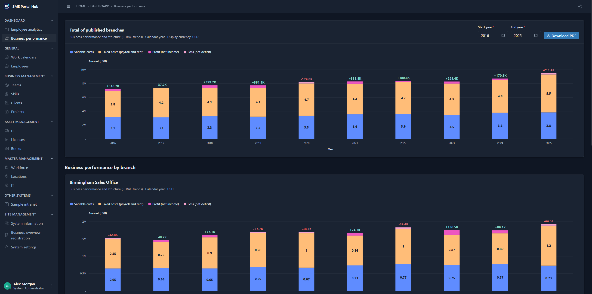
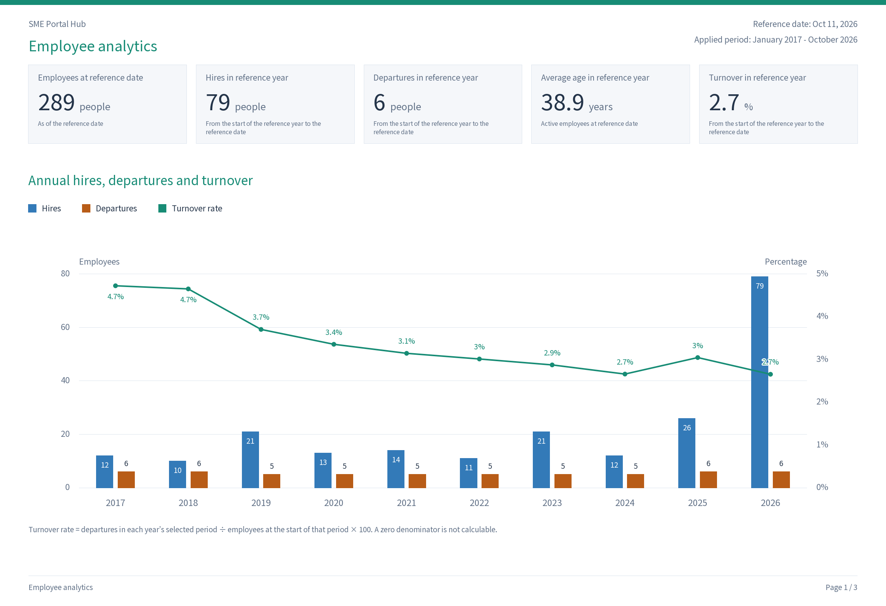
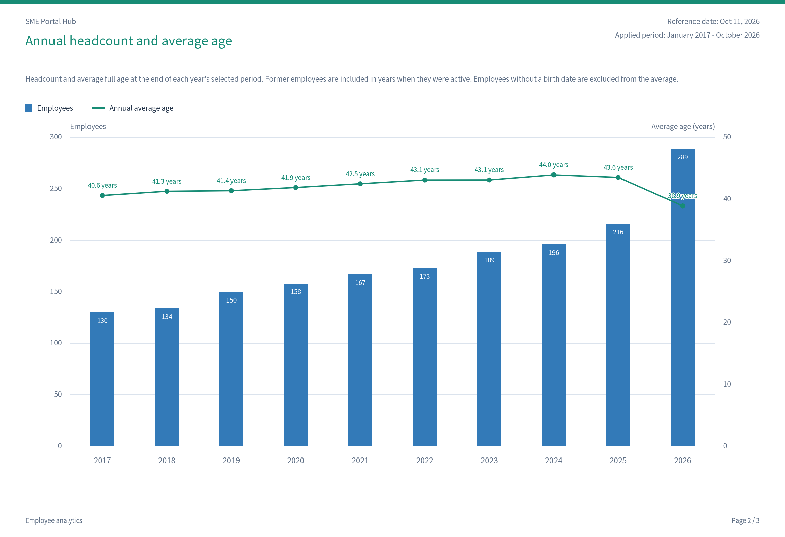
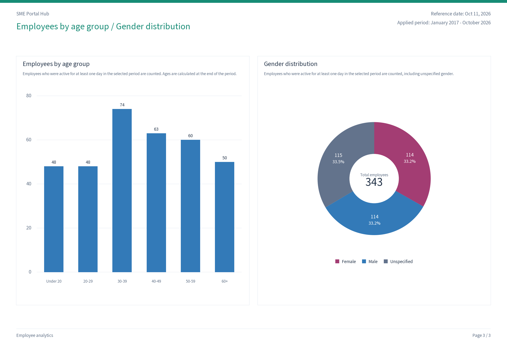
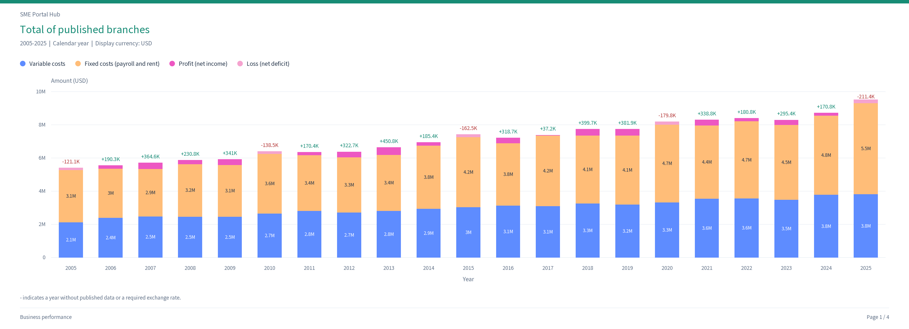
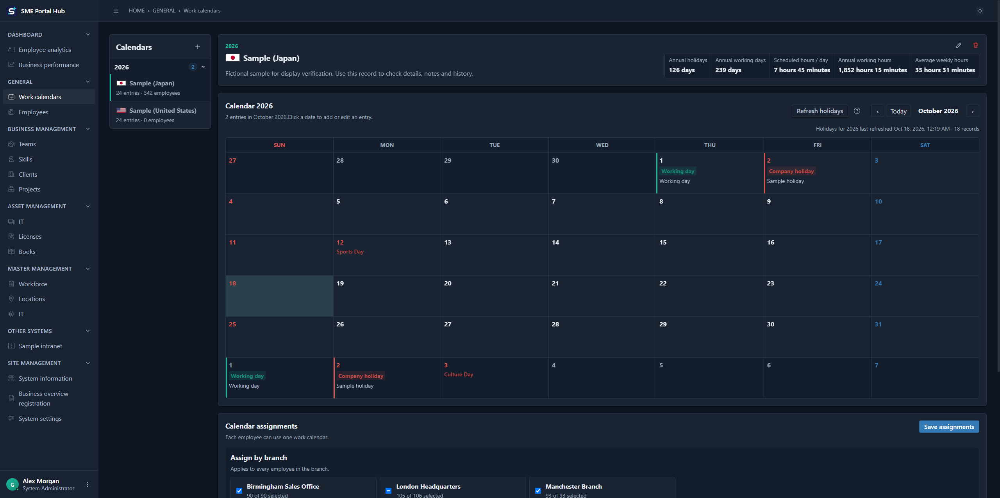
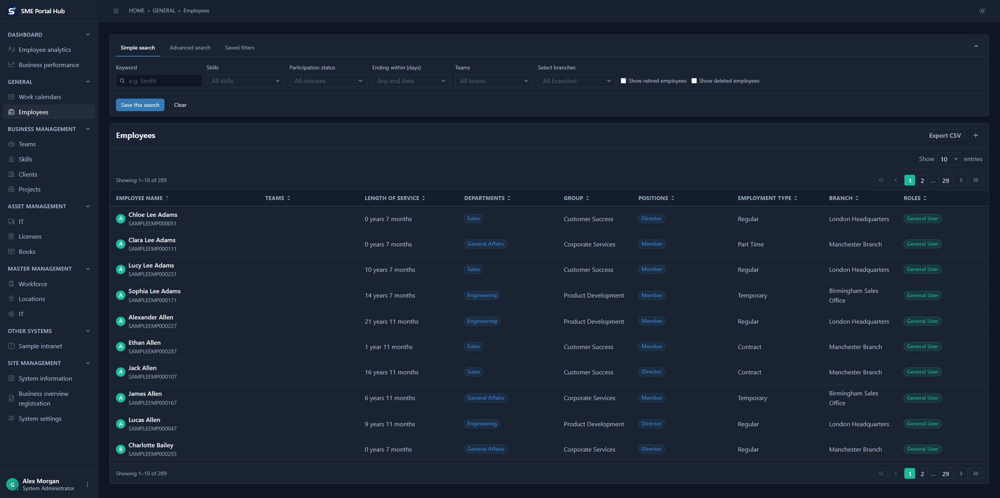

# SME Portal Hub ( SPH )

[日本語版はこちら](./README_JA.md)

[](https://github.com/HidekiMorisaki/sph/releases) [](https://github.com/HidekiMorisaki/sph/blob/main/LICENSE)



SME Portal Hub (abbreviated as SPH) is a web-based system that enables small and medium-sized enterprises to build their own internal portal sites. It is being developed to streamline internal operations and bring company information together in one place through capabilities such as employee management, internal calendar creation and publishing, and IT asset management.

> [!NOTE]
> SPH is currently under active development. It can be installed and evaluated, but some functionality remains incomplete. Existing features may also change substantially in future updates.

| Your goal | Read this section |
| --- | --- |
| Install, try, or use the system | [Quick Start for Users](#quick-start-for-users) |
| Try it on free cloud hosting | [Installing on blitz.cloud](#installing-on-blitz-cloud) |
| Install on a server for access from other PCs | [Installing on a server or another PC](#installing-on-a-server-or-another-pc) |
| Diagnose an installation problem | [Quick Start troubleshooting](#quick-start-troubleshooting) |
| Start or stop an existing installation | [Starting and stopping the system](#starting-and-stopping-the-system) |
| Upgrade an existing installation | [Upgrading to the latest version](#upgrading-to-the-latest-version) |

The system includes:

- Employee management and role-based access control
- Internal calendar creation and publishing
- Branch, room, and storage-location management
- IT asset records, assignments, returns, and change history
- Master data for employees and IT assets
- Employee analytics and published business performance trends, plus user settings
- Administrator-only financial figures by branch and year

Financial figures use the [Bank of Japan Time-Series Data Search](https://www.stat-search.boj.or.jp/index_en.html) API (FXERM07) for USD/JPY conversion. Monthly rates are stored in the database and are not automatically revised. If you install SPH and make it publicly available, review the [Bank of Japan API usage notice](https://www.stat-search.boj.or.jp/info/api_notice_en.pdf) and provide the required service notification before publication. The financial page displays the data source.
Optional installer samples include published financial periods and clearly marked
fictional exchange rates so the trends can be explored without a live API request.

## Quick Start for Users

### 1. Prerequisites

Git, Docker, and Docker Compose are required for installation. Install them beforehand and confirm that they work correctly.
Local-only installation uses host port `3000` by default (changeable in the installer). HTTPS installation uses ports `80` and `443`; internal HTTP uses the selected web port. PostgreSQL listens on the host's loopback port `5432`. Confirm that the needed ports are free.

### 2. Download

```bash
git clone https://github.com/HidekiMorisaki/sph.git
cd sph
```

### 3. Run the installer

| Platform | Run from the downloaded folder |
| --- | --- |
| Windows | Double-click `install.bat`, or run `.\install.ps1` in PowerShell. |
| macOS / Linux | Run `bash ./install.sh` in a terminal. |

The installer supports English and Japanese. After selecting the display language, follow the interactive prompts to install the system. The installer builds and starts the system, then shows the URL and sign-in instructions.

> [!NOTE]
> At the "Optional fictional sample data" prompt, select "2. Add localized samples" to automatically add sample data in the selected language. Use these samples to evaluate SPH.

<a id="installing-on-blitz-cloud"></a>

## Installing on blitz.cloud

This option runs SPH and PostgreSQL on the blitz.cloud free plan, without Docker on your own computer. Use it after the cloud-ready version reaches the public repository's `main` branch. On the free plan, idle apps sleep and database backups are kept for seven nights. This is intended for evaluation; review the service terms and backup options before entering real employee information.

1. Open the [blitz.cloud dashboard](https://dashboard.blitz.cloud/) and create a free account. You can register with email and password, GitHub, or Google. Confirm your email address when prompted, then claim your `<account-name>.blitz.cloud` address. Apps and databases cannot be created until your email is confirmed. See the [official getting-started guide](https://blitz.cloud/docs/getting-started/).
2. Choose **Host something new → My own code** and paste the public [`HidekiMorisaki/sph`](https://github.com/HidekiMorisaki/sph) repository. No fork or GitHub connection is needed to read this public project. In **Advanced settings**, choose the intended branch and confirm the parts: `frontend` at `/`, `v1` at `/v1` (rename an `api` suggestion), and `migration` as **Runs before each new version**. Keep `db` and `gateway` off if they are proposed. Leave **Needs a database** off; the installer will create and connect managed PostgreSQL. Choose an unused app address and submit the wizard. The first build may fail while database and administrator settings are missing.
3. Open **AI tools → Keys → Make a key**. Name the key something recognizable, such as `SPH installer`, and copy its value when it appears. It is shown only once. This key can manage your blitz.cloud apps and databases: keep it private and never put it in GitHub, screenshots, chats, or a command argument. Paste it into the installer's hidden prompt. If you lose it, issue another key; use **Revoke** on the same page when you no longer need one. See the [official API-key guide](https://blitz.cloud/docs/ai-assistants/).
4. Install [Node.js 22](https://nodejs.org/) and Git, then download the same public branch and run the installer:

   ```bash
   git clone https://github.com/HidekiMorisaki/sph.git
   cd sph
   node scripts/install-blitz.mjs
   ```

5. Enter the API key, confirm the suggested blitz.cloud account name (or enter it if the service does not return one), then enter the app address chosen in the wizard. The installer verifies the parts before requesting administrator details, creates and connects PostgreSQL, saves the settings, and starts a new build. Accept the profile defaults with Enter or edit them. Choose a strong password and enter it twice; the API key and password have no defaults. The installer checks `/v1/health`, session, administrator sign-in, and sign-out before it removes the initial administrator settings and prints the HTTPS address.

If installation stops, inspect **Overview / Activity / Logs / Settings → Parts** for the app in blitz.cloud. The MCP deployment command creates only one part, so the installer does not use it. An existing one-part app cannot be repaired by the installer; use the wizard to create a multi-part app at another address, or first confirm that the incomplete app and any linked database contain no data before removing them. Rerun the installer with the wizard app's address. Existing database and encryption settings are preserved on retries. After a successful retry, verify that the installer removed the initial administrator settings. You may revoke the API key in AI tools if you do not plan to use it again.

## Installing on a server or another PC

Run the download and installer steps on the machine that will host the system.
Choose a connection mode in the installer:

| Mode | URL and certificate | Network and trust requirements |
| --- | --- | --- |
| Local only | `http://localhost:3000` by default | Available only from the PC where SPH is installed. The web port binds only to that PC's loopback interface. |
| Internal HTTP | `http://` followed by the server's private IPv4 address and optional web port | Allow access only from devices on the local area network. All traffic, including passwords, session cookies, and employee and asset data, is unencrypted, but no server certificate is required. |
| Internal HTTPS | Your internal `https://` hostname, with a certificate issued and renewed by the built-in Caddy CA | Allow access only from devices on the local area network. Client devices must be able to reach TCP `443` on the server. An administrator must securely distribute the exported CA root certificate to each client and configure it as trusted. |
| Public domain | Your `https://` domain, with a Let's Encrypt certificate obtained and renewed automatically by the built-in gateway | Point public DNS to this server and make TCP `80` and `443` reachable from the internet. During installation, you must enter an ACME contact email address and accept the Let's Encrypt subscriber agreement. |

For the internal HTTPS mode, the installer exports the public CA root certificate to `.runtime/ca/root.crt`. Verify the certificate's identity on the server before distributing it to client devices through your organization's certificate management process. The CA private key is stored in Docker's `gateway_data` volume. Include the `gateway_data` volume in backups: losing it changes the CA and invalidates existing trust. Certificates are renewed automatically while the CA data persists.

For the public mode, verify DNS and firewall access before installation. Certificate issuance requires an internet-reachable domain and ports `80`/`443`; the installer checks DNS and waits for the HTTPS health endpoint. If it stops, inspect `docker compose -f docker-compose.local.yml logs gateway`, correct DNS/firewall reachability, and resume with the recovery instructions below. The ACME provider's [subscriber agreement](https://letsencrypt.org/repository/) applies.

Connection settings are saved in `.env` as `GATEWAY_TLS_MODE`, `GATEWAY_HTTP_PUBLISH`, `GATEWAY_HTTPS_PUBLISH`, `APP_ORIGIN`, `HTTP_PORT`, and `CORS_ALLOWED_ORIGINS` (plus `ACME_EMAIL` for a public domain). After changing them, regenerate `.runtime/gateway/Caddyfile` with `node scripts/install-maintenance.mjs gateway-config`, then run `docker compose -f docker-compose.local.yml up -d --build --no-deps api frontend gateway`. Do not edit the generated Caddyfile independently of `.env`.

## Quick Start troubleshooting

### The installer stopped

The installer is for new installations only. Existing `.env` files, SPH containers,
or the `sph-db-data` volume cause it to stop without replacing them. For an existing
installation, use the normal start, update, or recovery procedures.

Installation failures report the stopped stage, the failed
operation or detected condition, and the next checks to make. Docker's raw output
is suppressed because it can contain credentials. When the underlying cause is
unknown, the message says so; suggested checks are not a diagnosis.

If a new installation failed after saving `.env`, retain that file, `.runtime/gateway/Caddyfile`, database storage, and the `gateway_data` volume. Resolve the prerequisite or startup problem, then run
`docker compose -f docker-compose.local.yml up -d --build --wait --wait-timeout 300` from the product repository
root and check service status below. If the Caddyfile is missing, regenerate it with `node scripts/install-maintenance.mjs gateway-config` first. In internal mode, export the public CA root again with `docker cp sph-gateway:/data/caddy/pki/authorities/local/root.crt .runtime/ca/root.crt`. If no configuration or SPH storage was
created, rerun the installer. Never generate a replacement encryption key for
encrypted data. Keep `.env` protected and back it up separately from the database.

After recovering startup, finish the removal of initial setup credentials. Remove
only `INITIAL_ADMIN_*` lines from `.env`, retaining the database password and
encryption key. Recreate `db` and `api` with
`docker compose -f docker-compose.local.yml up -d --no-build --no-deps --force-recreate --wait --wait-timeout 300 db api`,
then remove the completed migration container with `docker compose -f docker-compose.local.yml rm -f migration`
and verify the application responses below. If `.env.install-clean` remains,
keep it protected until recovery is complete, then securely remove this temporary
file. It may contain credentials.

### Verify the installation

Show all containers, including the one-time migration container:

```bash
docker compose -f docker-compose.local.yml ps -a
```

The expected state is:

- `db`, `api`, `frontend`, and `gateway` are running.
- If present, the one-time `migration` container has exited with status code `0`.

If startup is still in progress or a service failed, inspect the logs:

```bash
docker compose -f docker-compose.local.yml logs migration
docker compose -f docker-compose.local.yml logs api frontend gateway db
```

Verify the API through the gateway. For local mode, replace the example port if changed:

```bash
curl http://localhost:3000/v1/health
```

Windows PowerShell users can run:

```powershell
Invoke-RestMethod http://localhost:3000/v1/health
```

A successful response reports that the `equipment-api` service is healthy.
For HTTPS modes, use the configured `https://` application URL instead. In internal mode, first trust `.runtime/ca/root.crt` on the checking device.

### The web page does not open

Check that all long-running services are running and healthy:

```bash
docker compose -f docker-compose.local.yml ps -a
docker compose -f docker-compose.local.yml logs gateway frontend api
```

Also confirm that the selected web port is not already used by another application.

### The migration container failed

Review its logs:

```bash
docker compose -f docker-compose.local.yml logs migration
```

Common causes include missing or invalid `INITIAL_ADMIN_*` values, an initial password that does not meet the strength requirements, or employment type and branch names that do not match the initial master data.

After correcting `.env`, rerun:

```bash
docker compose -f docker-compose.local.yml up -d --build
```

### A port is already in use

Local mode binds the gateway to host loopback port `3000` by default; HTTPS modes bind ports `80` and `443`; internal HTTP binds the selected port on the server's private IPv4 address. PostgreSQL binds only to host loopback port `5432`. Free the required ports before installation. For an existing local installation, change `HTTP_PORT`, `GATEWAY_HTTP_PUBLISH`, `APP_ORIGIN`, and `CORS_ALLOWED_ORIGINS` together, then regenerate the gateway configuration as described above.

### Bind mounts do not work

Some Docker environments cannot reliably bind-mount projects stored on removable drives. Move the repository to an internal drive, such as `C:\projects\sph`, and start the system again.

## Starting and stopping the system

View service status:

```bash
docker compose -f docker-compose.local.yml ps -a
```

Follow logs:

```bash
docker compose -f docker-compose.local.yml logs -f
```

Restart the application:

```bash
docker compose -f docker-compose.local.yml restart
```

Stop and remove the containers while preserving database data:

```bash
docker compose -f docker-compose.local.yml down
```

Start the existing installation again:

```bash
docker compose -f docker-compose.local.yml up -d
```

Database data is stored in the named Docker volume `sph-db-data` and is retained by `docker compose -f docker-compose.local.yml down`. Do not add the `--volumes` option unless permanent data removal is intentional and a suitable backup exists.

## Upgrading to the latest version

To update an installed system, run the command for your operating system from the repository root. The update script stops services, creates and verifies a backup, then pulls source changes and restarts the system. Make sure the Git working tree is clean and the branch has an upstream remote.

### Updating from v0.3.0 or later

Windows PowerShell:

```powershell
.\scripts\update.ps1
```

macOS or Linux:

```bash
./scripts/update.sh
```

### Updating from v0.2.1

The original v0.2.1 PowerShell script is incompatible with Windows PowerShell 5.1. Fetch the v0.2.1 maintenance fix first, then point the checkout at the v0.3.0 release branch. After v0.3.0 is published on `main`, run these commands from the repository root:

```powershell
git fetch origin
git pull --ff-only origin bugfix/v0.2.1
git branch --set-upstream-to=origin/main
.\scripts\update.ps1
```

On macOS/Linux, use the same Git commands and run `./scripts/update.sh` for the final command. The update script creates and verifies a database backup before it pulls v0.3.0. If the checkout has local changes, resolve them before starting; do not discard them as part of the update.

For backup locations and recovery steps, see [Backup, update, and restore](./docs/Backup_Update_and_Restore.md).

## Gallery

### Dashboard



### PDF export results





## Work calendars


## Employee list


## Acknowledgements

The UI design of SPH was inspired by [Gentelella v4 - Free Admin Dashboard Template](https://github.com/colorlibhq/gentelella). We are grateful to the Gentelella contributors—and to all developers who generously make high-quality design templates available to the community at no cost.

SPH uses the following external APIs and public data sources. We thank their providers for making these services and data available.

- [zipcloud Postal Code Search API](https://zipcloud.ibsnet.co.jp/doc/api): Looks up Japanese address candidates from postal codes.
- [Zippopotam.us API](https://zippopotam.us/): Looks up U.S. address candidates from ZIP codes.
- [Bank of Japan Time-Series Data Search API](https://www.stat-search.boj.or.jp/index_en.html): Retrieves monthly average USD/JPY exchange rates for converting financial figures. The Bank of Japan does not guarantee the content of SPH.
- [Cabinet Office of Japan public holiday data](https://www8.cao.go.jp/chosei/shukujitsu/gaiyou.html): Supplies the public CSV data imported into Japanese work calendars.
- [U.S. Office of Personnel Management (OPM) federal holiday data](https://www.opm.gov/policy-data-oversight/pay-leave/federal-holidays/): Supplies the public iCalendar data imported into U.S. work calendars.
- [GitHub Releases API](https://docs.github.com/en/rest/releases/releases): Checks for newer published versions on the System Information page.
