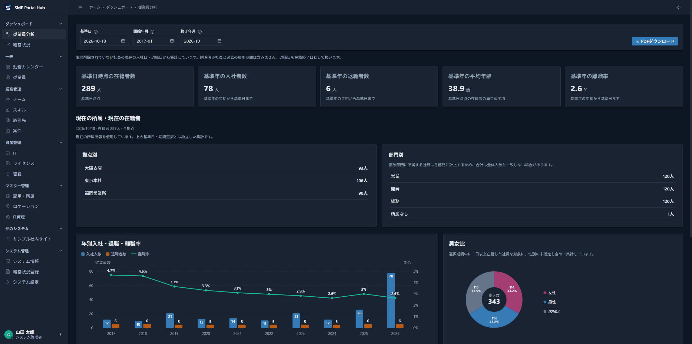
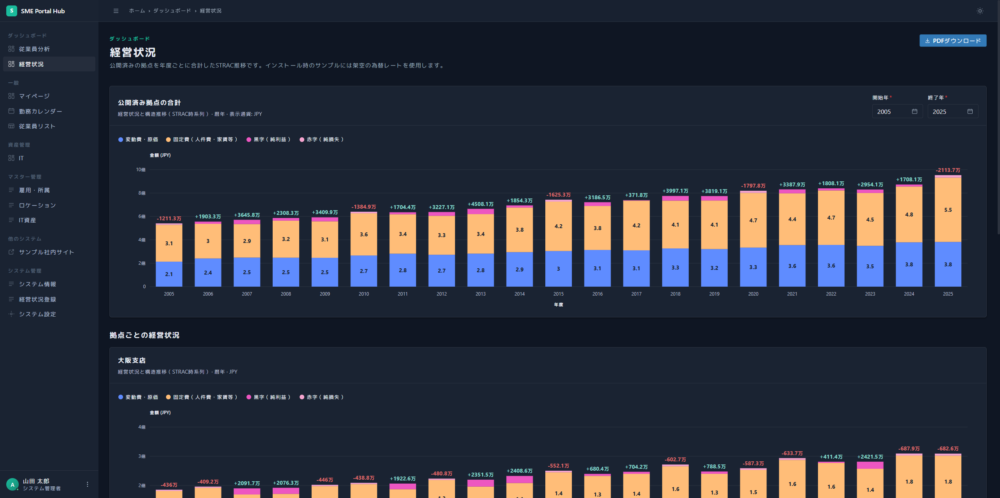
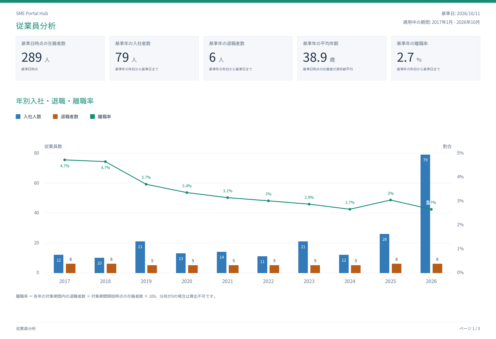
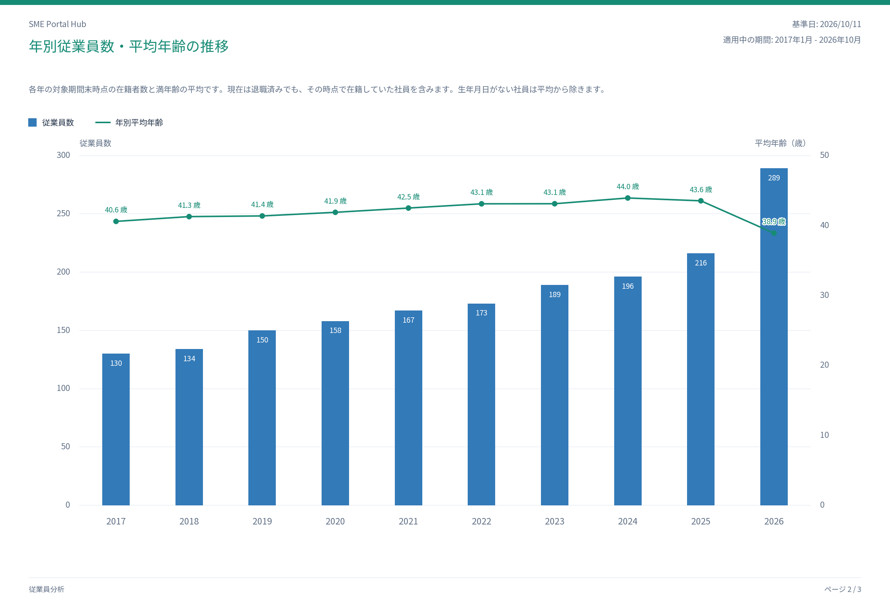
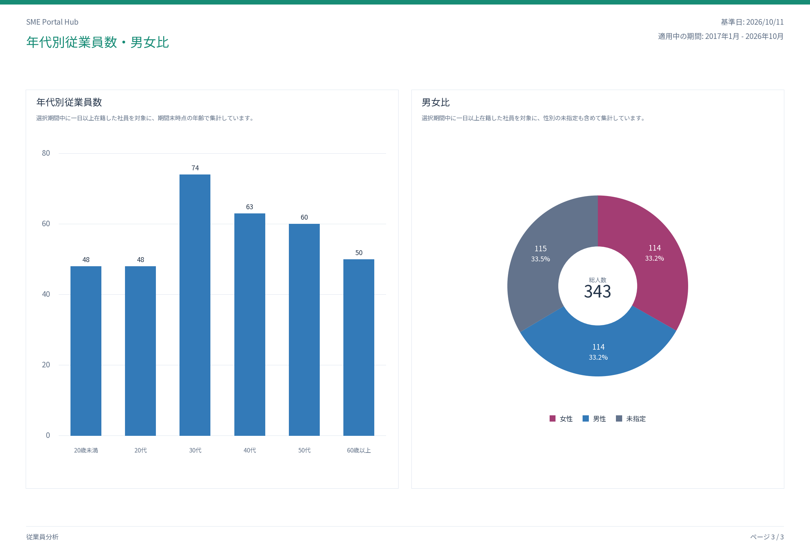
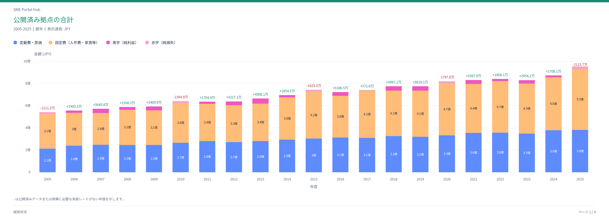
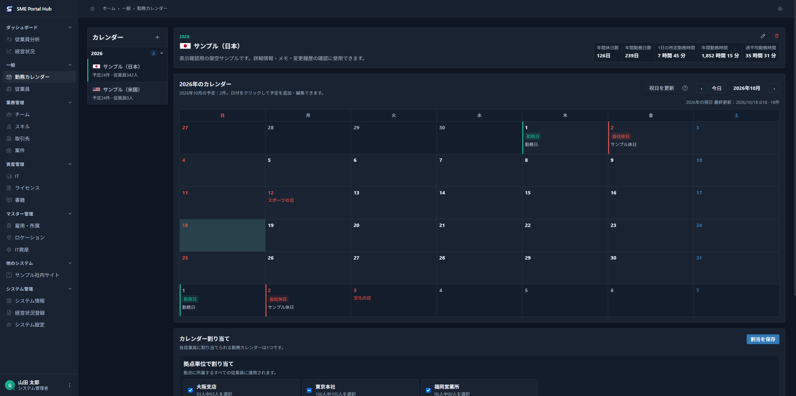
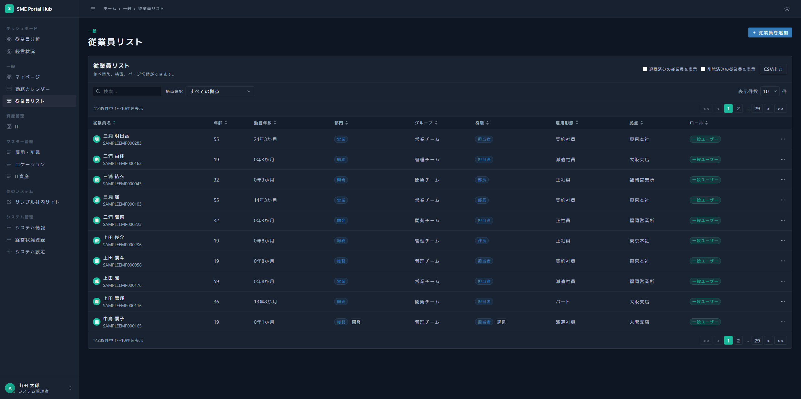

# SME Portal Hub ( SPH )

[English](./README.md)

[](https://github.com/HidekiMorisaki/sph/releases) [](https://github.com/HidekiMorisaki/sph/blob/main/LICENSE)



SME Portal Hub ( 略称：SPH ) は、中小企業が社内向けのポータルサイトを構築できる Web システムです。従業員管理、社内カレンダーの作成・公開、IT 資産管理などを通じて、社内業務の効率化と情報の集約を支援することを目指して開発しています。

> [!NOTE]
> SPH は現在、開発中です。
インストールして評価できますが、一部の機能は未完成です。既存機能も今後のアップデートで大幅に変更される可能性があります。

| 目的 | 参照するセクション |
| --- | --- |
| インストール・試用・利用する | [利用者向けクイックスタート](#quick-start-for-users) |
| 無料クラウドで試す | [blitz.cloud へのインストール](#installing-on-blitz-cloud) |
| 他の PC から利用できるようにサーバーへインストールする | [サーバーまたは別の PC へのインストール](#installing-on-a-server-or-another-pc) |
| インストール時の問題を調べる | [クイックスタートのトラブルシューティング](#quick-start-troubleshooting) |
| インストール済みのシステムを起動・停止する | [システムの起動と停止](#starting-and-stopping-the-system) |
| インストール済みのシステムを更新する | [最新バージョンへの更新](#upgrading-to-the-latest-version) |

本システムには、次の機能があります。

- 従業員管理とロールに基づくアクセス制御
- 社内カレンダーの作成・公開
- 拠点・部屋・保管場所の管理
- IT 資産の登録・割当・返却・変更履歴
- 従業員とIT資産に関するマスターデータ
- 従業員分析と公開済み経営状況の推移、ユーザー設定
- システム管理者向けの拠点・年度別の経営状況管理

経営状況のドル／円換算には、[日本銀行時系列統計データ検索サイト](https://www.stat-search.boj.or.jp/) の API（FXERM07）を利用します。取得した月別レートは DB に保存され、自動改訂しません。SPH をインストールして外部に公開する場合は、公開する前に [日本銀行の API 利用上の注意](https://www.stat-search.boj.or.jp/info/api_notice.pdf) を確認し、必要なサービス利用の連絡を行ってください。画面には出典を表示しています。
オプションのインストール用サンプルには、公開済みの経営状況と、サンプル専用であることを明示した架空の為替レートを含みます。

<a id="quick-start-for-users"></a>

## 利用者向けクイックスタート

### 1. 事前準備

インストールするには Git、Docker、Docker Compose が必要です。事前にインストールして正常に動作することを確認してください。
ローカル限定インストールでは既定でホストのポート`3000`を使用します（インストーラーで変更可能）。HTTPS インストールでは`80`と`443`、社内 HTTP では選択した Web ポートを使用します。PostgreSQL はホストのループバック用ポート`5432`で待ち受けます。必要なポートが空いていることを確認してください。

### 2. ダウンロード

```bash
git clone https://github.com/HidekiMorisaki/sph.git
cd sph
```

### 3. インストーラーの実行

| プラットフォーム | ダウンロードしたフォルダーでの実行方法 |
| --- | --- |
| Windows | `install.bat`をダブルクリック、または PowerShell で`.\install.ps1`を実行 |
| macOS / Linux | ターミナルで`bash ./install.sh`を実行 |

インストーラーは英語と日本語に対応しています。表示言語を選択した後は、対話形式でインストールを行います。画面の案内に従ってインストールを行ってください。インストーラーがシステムをビルドして起動し、URL とログイン方法を表示します。

> [!NOTE]
> "架空のサンプルデータ（任意）" で "2：追加する" を選択することで、選択した言語に合わせたサンプルデータを自動的に追加することができます。SPH の評価にお役立てください。

<a id="installing-on-blitz-cloud"></a>

## blitz.cloudへのインストール

この方法では、SPH と PostgreSQL を blitz.cloud の無料枠で動かします。Docker を手元の PC で動かす必要はありません。無料枠での使用は評価目的にとどめ、本番運用を前提にする場合は有償プランの契約を推奨します。

1. [blitz.cloudのダッシュボード](https://dashboard.blitz.cloud/) を開き、無料アカウントを作成します。メールアドレスとパスワード、GitHub、Google のいずれかで登録できます。確認メールが届いたらメールアドレスを確認し、案内に従って自分の `<アカウント名>.blitz.cloud` というアドレスを取得します。[公式の登録手順](https://blitz.cloud/docs/getting-started/) も参照してください。
2. **Host something new --> My own code** を選び、公開リポジトリ [`HidekiMorisaki/sph`](https://github.com/HidekiMorisaki/sph) の URL を入力します。公開リポジトリを読むための GitHub 連携やリポジトリのフォークは不要です。**Advanced settings** で `main`ブランチを選び、次の 3 パートを確認・修正します。`frontend` はルートの `Dockerfile` で`/`、`v1` は `api/Dockerfile` で`/v1`、`migration` は `sh -c 'npm run db:deploy && npm run admin:create'` を実行する **Runs before each new version** です。`db` と `gateway` が提案された場合は使用しません。**Needs a database** はオフにし、管理 PostgreSQL はインストーラーで作成・接続します。未使用のアプリ名を選んでウィザードを完了します。DB と管理者設定がまだないため、最初のビルドが失敗しても、この時点ではアプリや DB を削除しないでください。
3. ダッシュボードの **AI tools --> Keys --> Make a key** を開き、`SPH installer` など用途が分かる名前で API キーを発行します。発行直後に表示される値を安全な場所へコピーしてください。再表示はできません。インストーラーから API キーの入力を求められた場合は、非表示の入力欄へ貼り付けてください。紛失時は同じ画面で再発行し、不要になったキーは **Revoke** で失効できます。[APIキーの公式説明](https://blitz.cloud/docs/ai-assistants/) も参照してください。
4. [Node.js 22](https://nodejs.org/) と Git を用意し、ウィザードと同じブランチを取得してインストーラーを実行します。

   ```bash
   git clone --branch main --single-branch https://github.com/HidekiMorisaki/sph.git
   cd sph
   node scripts/install-blitz.mjs
   ```

5. API キーを入力し、表示された blitz.cloud のアカウント名を確認します（取得できない場合は入力します）。ウィザードで選んだアプリのサブドメインを入力します。blitz.cloud の管理 API がパート構成を返さない場合は、ダッシュボードの **Settings --> Parts** で上記 3 パートを確認してから、インストーラーへ`VERIFY` と入力します。インストーラーは管理 PostgreSQL を作成・接続し、初期管理者情報を尋ねます。プロフィールは Enter で既定値を選べます。API キーとパスワードには既定値がなく、パスワードは確認入力も必要です。ビルド後に `/v1/health`、セッション、管理者ログイン、ログアウトを確認し、初期管理者設定を削除して HTTPS URL を表示します。

途中で止まった場合は、アプリを削除せずに blitz.cloud の **Activity** でビルド、**Logs --> migration** で DB 移行と管理者作成、**Settings --> Parts** で 3 パート、**Environment** で設定名の有無を確認します。設定値や API キーをログ・問い合わせに載せないでください。ビルドや起動が失敗した場合は原因を修正し、同じブランチ・アドレスでインストーラーを再実行します。再実行時は既存 DB と暗号化キーを保持し、管理者がすでに作成されている場合は最初に指定したログイン情報を入力します。

インストーラーが `/v1/health` の待機時間切れで終了しても、ビルドが後から完了する場合があります。**Activity** で公開状態を確認し、`https://<アプリ名>.<アカウント名>.blitz.cloud/v1/health` が `responseCode: 200` のJSONを返すこと、未ログインの `/v1/auth/session` が 401 の JSON を返すこと、管理者でログイン・ログアウトできることを確認してください。すべて成功していればインストーラーを再実行する必要はありません。**Environment** から `INITIAL_ADMIN_*` をすべて削除して **Restart now** を押し、再起動後のヘルスチェックを確認します。`DATABASE_URL` と `IT_ASSET_CREDENTIAL_ENCRYPTION_KEY` は削除せずに残してください。API キーを再利用しない場合は **AI tools** で失効できます。

<a id="installing-on-a-server-or-another-pc"></a>

## サーバーまたは別の PC へのインストール

システムを稼働させるコンピューターで、ダウンロードとインストーラーの実行を行ってください。インストーラーで接続方式を選びます。

| 方式 | URL と証明書 | ネットワークと信頼設定 |
| --- | --- | --- |
| ローカル限定 | 既定は`http://localhost:3000` | SPH をインストールした PC のみから利用可能。Web ポートはインストールした PC のループバックにのみ公開されます。 |
| 社内 HTTP | サーバーのプライベート IPv4 アドレスを使う`http://` URL | ローカルエリアネットワーク上の端末のみからアクセスを許可します。パスワード、セッション Cookie、社員・資産情報を含む全通信が暗号化されない代わりに、サーバー証明書は不要です。 |
| 社内 HTTPS | 指定した社内`https://`ホスト名。内蔵 Caddy CA が証明書を発行・更新します。 | ローカルエリアネットワーク上の端末のみからアクセスを許可します。利用端末からサーバーの TCP `443`へ到達できるようにする必要があります。管理者が公開 CA ルート証明書を各端末へ安全に配布し、信頼設定を行ってください。 |
| 公開ドメイン | 指定した`https://`ドメイン。内蔵 gateway が Let's Encrypt の証明書を自動取得・更新します。 | 公開 DNS をサーバーへ向け、インターネットから TCP `80` と `443` に到達できるようにしてください。インストール中に ACME 連絡先メールアドレスの入力と Let's Encrypt の利用規約への同意が必要です。 |

社内 HTTPS 方式では、公開 CA ルート証明書を `.runtime/ca/root.crt` ファイルへ出力します。サーバー上で証明書の同一性を確認してから、組織の証明書管理手順に沿って利用端末へ配布してください。CA 秘密鍵は Docker の `gateway_data` ボリュームに保存されています。`gateway_data` ボリュームはバックアップに含めてください。失うと CA が変わり、既存の信頼設定が無効になります。CA データが保持されている間は証明書が自動更新されます。

公開ドメイン方式では、インストール前に DNS とファイアウォールを確認してください。証明書の取得には、インターネットから到達可能なドメインとポート`80`/`443`が必要です。インストーラーは DNS を確認し、HTTPS のヘルスチェックを待ちます。停止した場合は`docker compose -f docker-compose.local.yml logs gateway`を確認し、到達性を修正してから下記の復旧手順を実施してください。[Let's Encrypt の利用規約](https://letsencrypt.org/repository/)が適用されます。

接続設定は`.env`の`GATEWAY_TLS_MODE`、`GATEWAY_HTTP_PUBLISH`、`GATEWAY_HTTPS_PUBLISH`、`APP_ORIGIN`、`HTTP_PORT`、`CORS_ALLOWED_ORIGINS`（公開ドメインでは`ACME_EMAIL`も）に保存されます。変更した場合は`node scripts/install-maintenance.mjs gateway-config`で`.runtime/gateway/Caddyfile`を再生成し、`docker compose -f docker-compose.local.yml up -d --build --no-deps api frontend gateway`を実行します。生成された Caddyfile だけを独立して編集しないでください。

<a id="quick-start-troubleshooting"></a>

## クイックスタートのトラブルシューティング

### インストーラーが停止した場合

インストーラーは新規インストール専用です。既存の`.env`ファイル、SPH のコンテナー、または`sph-db-data`ボリュームがある場合は、それらを置き換えずに停止します。インストール済みの環境では、通常の起動・更新・復旧手順を使用してください。

インストールに失敗した場合は、停止した工程、失敗した操作または検出した状態、次に確認する事項を表示します。Docker の出力には認証情報が含まれる可能性があるため、そのまま表示することはありません。詳細な原因が不明な場合は、その旨を明示します。表示する確認事項は、原因を断定したものではありません。

新規インストールが`.env`の保存後に失敗した場合は、そのファイル、`.runtime/gateway/Caddyfile`、データベース保存領域、`gateway_data`ボリュームを保持してください。事前条件や起動時の問題を解消してから、製品リポジトリのルートで`docker compose -f docker-compose.local.yml up -d --build --wait --wait-timeout 300`を実行し、後述のサービス状態を確認してください。Caddyfile がない場合は、先に`node scripts/install-maintenance.mjs gateway-config`で再生成します。社内限定方式では`docker cp sph-gateway:/data/caddy/pki/authorities/local/root.crt .runtime/ca/root.crt`で公開 CA ルートを再出力します。設定ファイルも SPH の保存領域も作成されていない場合は、インストーラーを再実行します。暗号化済みデータに対して、暗号化キーを新しく生成して置き換えないでください。`.env`は安全に保管し、データベースとは別にバックアップしてください。

起動を復旧した後は、初期設定用の認証情報の除去も完了させてください。データベースのパスワードと暗号化キーを保持したまま、`.env`から`INITIAL_ADMIN_*`の行だけを削除します。`docker compose -f docker-compose.local.yml up -d --no-build --no-deps --force-recreate --wait --wait-timeout 300 db api`で`db`と`api`を再作成し、`docker compose -f docker-compose.local.yml rm -f migration`で完了した migration コンテナーを削除してから、後述のアプリケーションの応答を確認してください。`.env.install-clean`が残っている場合は、復旧が完了するまで保護し、完了後にこの一時ファイルを安全に削除してください。認証情報が含まれる可能性があります。

### インストール結果の確認

一度だけ実行される migration コンテナーも含め、すべてのコンテナーを表示します。

```bash
docker compose -f docker-compose.local.yml ps -a
```

次の状態になっていることを確認してください。

- `db`、`api`、`frontend`、`gateway`が稼働している。
- 一度だけ実行される`migration`コンテナーが存在する場合は、終了コード`0`で終了している。

起動処理がまだ続いている場合やサービスが失敗した場合は、ログを確認します。

```bash
docker compose -f docker-compose.local.yml logs migration
docker compose -f docker-compose.local.yml logs api frontend gateway db
```

gateway 経由で API を確認します（ポートを変更した場合は、例のポート番号を置き換えてください）。

```bash
curl http://localhost:3000/v1/health
```

Windows の PowerShell では、次のコマンドを使用できます。

```powershell
Invoke-RestMethod http://localhost:3000/v1/health
```

成功した場合は、`equipment-api`サービスが正常であることを示す応答が返ります。HTTPS 方式では、設定した`https://`のアプリ URL で確認してください。社内限定方式では、確認端末で`.runtime/ca/root.crt`を信頼してから確認します。

### Web ページが開かない場合

常時稼働するサービスがすべて起動し、正常な状態であることを確認してください。

```bash
docker compose -f docker-compose.local.yml ps -a
docker compose -f docker-compose.local.yml logs gateway frontend api
```

選択した Web ポートが、他のアプリケーションで使用されていないことも確認してください。

### migrationコンテナーが失敗した場合

ログを確認してください。

```bash
docker compose -f docker-compose.local.yml logs migration
```

よくある原因には、`INITIAL_ADMIN_*`の値の不足・不正、強度要件を満たさない初期パスワード、初期マスターデータと一致しない雇用形態名や拠点名があります。

`.env`を修正してから、次のコマンドを再実行してください。

```bash
docker compose -f docker-compose.local.yml up -d --build
```

### ポートが既に使用されている場合

ローカル方式では既定で gateway をホストのループバック用ポート`3000`に、HTTPS 方式では`80`と`443`に、社内 HTTP 方式ではサーバーのプライベート IPv4 アドレス上の選択したポートに公開します。PostgreSQL はホストのループバック用ポート`5432`だけに公開します。必要なポートを空けてください。既存のローカル環境でポートを変更する場合は、`.env`の`HTTP_PORT`、`GATEWAY_HTTP_PUBLISH`、`APP_ORIGIN`、`CORS_ALLOWED_ORIGINS`を一緒に変更し、上記の手順で gateway 設定を再生成します。

### バインドマウントが機能しない場合

Docker の環境によっては、リムーバブルドライブ上のプロジェクトを正常にバインドマウントできないことがあります。リポジトリを`C:\projects\sph`などの内蔵ドライブへ移動し、システムを再度起動してください。

<a id="starting-and-stopping-the-system"></a>

## システムの起動と停止

サービスの状態を表示します。

```bash
docker compose -f docker-compose.local.yml ps -a
```

ログを継続して表示します。

```bash
docker compose -f docker-compose.local.yml logs -f
```

アプリケーションを再起動します。

```bash
docker compose -f docker-compose.local.yml restart
```

データベースのデータを保持したまま、コンテナーを停止・削除します。

```bash
docker compose -f docker-compose.local.yml down
```

インストール済みの環境を再度起動します。

```bash
docker compose -f docker-compose.local.yml up -d
```

データベースのデータは、名前付き Docker ボリューム`sph-db-data`に保存され、`docker compose -f docker-compose.local.yml down`を実行しても保持されます。データの永久削除を意図し、適切なバックアップがある場合を除き、`--volumes`オプションを追加しないでください。

<a id="upgrading-to-the-latest-version"></a>

## 最新バージョンへの更新

インストール済みの環境を更新する場合は、リポジトリのルートから使用中の OS に対応するコマンドを実行してください。更新スクリプトがサービスを停止し、検証付きバックアップを作成してから、ソースの取得・再起動を行います。事前に Git の作業ツリーをクリーンにし、追跡先のブランチを設定してください。

### v0.3.0 以上から更新する場合

Windows PowerShell:

```powershell
.\scripts\update.ps1
```

macOS／Linux:

```bash
./scripts/update.sh
```

### v0.2.1 から更新する場合

公開済みの元の v0.2.1 に含まれる PowerShell スクリプトは Windows PowerShell 5.1 に対応していません。先に v0.2.1 向け保守修正を取得し、その後、追跡先を v0.3.0 のリリースブランチに設定してください。v0.3.0 が `main` に公開されたら、リポジトリのルートで次を実行します。

```powershell
git fetch origin
git pull --ff-only origin bugfix/v0.2.1
git branch --set-upstream-to=origin/main
.\scripts\update.ps1
```

macOS／Linux では同じ Git コマンドを実行し、最後のコマンドを `./scripts/update.sh` に置き換えてください。更新スクリプトは v0.3.0 のソースを取得する前に、データベースのバックアップを作成・検証します。ローカルに変更がある場合は事前に内容を確認して解消し、更新のために無断で破棄しないでください。

バックアップ先の指定や復旧方法は [バックアップ・更新・復元手順](./docs/Backup_Update_and_Restore_JA.md) を参照してください。

## ギャラリー

### ダッシュボード



### PDF エクスポート結果





## 勤務カレンダー


## 従業員リスト


## 謝辞

SPH の UI デザインは、[Gentelella v4 - Free Admin Dashboard Template](https://github.com/colorlibhq/gentelella) を参考にさせていただきました。Gentelella の貢献者の皆様、そして高品質なデザインテンプレートを無償でコミュニティに公開してくださるすべての開発者の皆様に感謝します。

SPH は、次の外部 API・公開データを利用しています。データとサービスの提供者の皆様に感謝します。

- [zipcloud 郵便番号検索 API](https://zipcloud.ibsnet.co.jp/doc/api)：日本の郵便番号から住所候補を取得します。
- [Zippopotam.us API](https://zippopotam.us/)：米国の ZIP コードから住所候補を取得します。
- [日本銀行時系列統計データ検索サイトの API](https://www.stat-search.boj.or.jp/)：経営状況の金額換算に使用するドル／円の月中平均為替レートを取得します。日本銀行は SPH の内容を保証するものではありません。
- [内閣府「国民の祝日」データ](https://www8.cao.go.jp/chosei/shukujitsu/gaiyou.html)：日本の勤務カレンダーに祝日を取り込むため、公開 CSV データを利用します。
- [米国人事管理局（OPM）の連邦祝日データ](https://www.opm.gov/policy-data-oversight/pay-leave/federal-holidays/)：米国の勤務カレンダーに連邦祝日を取り込むため、公開 iCalendar データを利用します。
- [GitHub Releases API](https://docs.github.com/en/rest/releases/releases)：システム情報ページで新しい公開版の有無を確認します。
